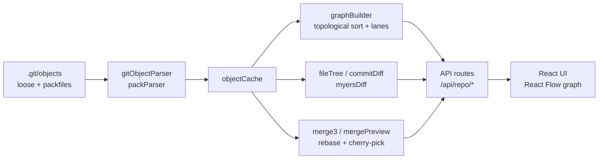

<div align="center">

# Git Version Control Visualizer

**See your repository the way Git does.**
Point it at any local repo or public GitHub URL and explore the commit graph, files, diffs, blame, merges and the raw objects underneath, **without ever asking the `git` CLI to read your history.**


[Quick start](#-quick-start) · [Deploy](#-deploy-on-render) · [Features](#-features) · [How it works](#-how-it-works) · [Keyboard shortcuts](#-keyboard-shortcuts) · [API](#-api-reference) · [Testing](#-testing) · [Troubleshooting](#-troubleshooting)

</div>

---

## Why this exists

Most Git GUIs wrap the `git` command and show you its output. This project does something different: it **re-implements the reading side of Git from scratch**. It inflates loose objects, parses packfile indexes, resolves delta chains, walks trees, runs its own Myers diff and three-way merge, and draws the result as an interactive graph.

That makes it two things at once:

- a **fast, friendly explorer** for any repository's history, and
- a **living explanation of Git's internals**: every commit, tree and blob you see is one you can open in the **Raw** tab and verify against its SHA-1.

> `git` is invoked for exactly one job: the network transfer (`git clone` / `git fetch`) when you open a GitHub URL. Reading and decoding objects never shells out.

---

## 🌐 Deploy on Render

The repo includes a `Dockerfile` and a `render.yaml` Blueprint, so deploying is a few clicks. The hosted build runs in a **locked-down mode**: only public `https://github.com/<owner>/<repo>` URLs are accepted, and local paths are refused (see [Security](#-security)).

**1. Push the project to GitHub** (with `Dockerfile` and `render.yaml` at the top level).

**2. Create the service on Render**

1. Sign in at [render.com](https://render.com) with GitHub.
2. Click **New +** → **Blueprint**, pick this repository, and click **Apply**.
   Render reads `render.yaml`, builds the Docker image and starts the service.
   *(Prefer clicking through? **New +** → **Web Service** → choose the repo → **Runtime: Docker**, set **Health Check Path** to `/api/health`, and add the environment variables below.)*
3. Wait for the first build (a few minutes). Your app is then live at `https://<service-name>.onrender.com`.

**3. Check it**

- Open the URL and paste `https://github.com/octocat/Hello-World`.
- `https://<service-name>.onrender.com/api/health` should return `{"ok":true}`.
- Pasting a local path such as `/etc` should show *"Local paths are disabled on this server"*.

**Good to know on the free plan**

- The service **sleeps after ~15 minutes idle**, so the first visit after a pause takes about a minute to wake.
- The disk is **not persistent**: cloned repositories are cached only until the next restart or deploy, then re-cloned on demand.
- It has **512 MB RAM**, which is why `MAX_REPO_MB` defaults to 200 in `render.yaml`. For big repositories or always-on hosting, choose a paid instance.

**Environment variables**

| Variable | Default | What it does |
|---|---|---|
| `ALLOW_LOCAL_PATHS` | `true` locally, `false` in Docker | `false` = hosted mode: only public GitHub URLs, no local paths |
| `MAX_REPO_MB` | `200` in Docker (unlimited locally) | Abort a clone that grows past this size |
| `MAX_CACHED_REPOS` | `25` (`15` in Docker) | Keep at most this many clones; least recently used are deleted |
| `MAX_CONCURRENT_CLONES` | `2` | Clones allowed at once; extra requests get a "server busy" message |
| `RATE_LIMIT_PER_MIN` | `300` | Per-IP API requests per minute (`0` turns it off) |
| `CLONE_CACHE_DIR` | `/data/clones` in Docker | Where clones are stored |
| `PORT` | `10000` in Docker | Provided by Render automatically |

**Run the container yourself**

```bash
docker build -t git-visualizer .
docker run --rm -p 3000:10000 git-visualizer     # then open http://localhost:3000
```

---

## 🔒 Security

Opening a repository means the server reads files and runs `git clone`, so a public deployment is hardened:

| Risk | Protection |
|---|---|
| **Command injection** through the URL | `git` is started with an argument list (never a shell string), the URL comes after `--`, and URLs with shell or control characters are rejected |
| **Reading the server's own files** | Hosted mode refuses every local path; only `https://github.com/<owner>/<repo>` is accepted |
| **Other protocols** (`file://`, `ssh`, credentials in URLs) | Blocked: hosted mode allows HTTPS to github.com only, and `GIT_ALLOW_PROTOCOL` / `protocol.file.allow=never` are set on every git call |
| **Hanging or huge clones** | 5-minute timeout, `MAX_REPO_MB` size cap enforced *while* cloning, and at most `MAX_CONCURRENT_CLONES` at once |
| **One slow clone freezing everyone** | Clones are asynchronous, and simultaneous requests for the same repo share one clone |
| **Disk filling up** | `--no-checkout` clones (objects only), plus least-recently-used eviction beyond `MAX_CACHED_REPOS` |
| **Request flooding** | Per-IP rate limit on `/api/repo/*` (HTTP 429 with `Retry-After`) |
| **Information leaks** | Hosted error messages omit raw git output and server paths; the container runs as a non-root user; security headers are set |

Run the checks (they include real clones, so they need network access):

```bash
npm run test:security
```

> Running locally with a **local path** is still the intended personal use: `ALLOW_LOCAL_PATHS` defaults to `true` outside Docker. Only the hosted build restricts input.

---

## ✨ Features

### Commit graph

- **Branch-lane graph** laid out the way `git log --graph` thinks: lanes open at forks and close at merges, with a stable colour per branch.
- **Pan, zoom, minimap, fit-to-view** and "jump to newest", built on React Flow. Only visible rows are rendered, so histories of thousands of commits stay smooth, and panning is bounded so the first and last commits are always reachable.
- **Search and filters** by text, author, branch and date range, with next/previous match navigation.
- **Replay bar**: drag to rewind history, or press play to watch the repository grow at 1×, 2× or 4×.
- **Branch and tag labels**, release-tag detection (`v1.2.0`), a `HEAD` marker and merge markers.
- **Progressive loading**: 500 commits first, then load more (1k / 2k / 5k) on demand.
- **Shareable links** to a repository and a specific commit.

### Inspect any commit

| Tab | What you get |
|---|---|
| **Details** | Author, committer, dates, parents, full message, copy-able hashes |
| **Files** | The whole repository **as it was at that commit**, with a resizable file list, syntax-highlighted content, **blame** and per-file **history** |
| **Changes** | Files changed with `+/-` counts and line-level diffs (unified, or side-by-side on wide screens) |
| **Raw** | The actual Git object: header, storage form (loose or packed), hex dump of the hashed bytes, and a recomputed SHA-1 check |

### Compare things

- **Compare two commits**: pick A and B on the graph (a tap on touch screens) and see exactly what changed between them. Swap, reset, or reopen the result at any time.
- **Compare two branches**: ahead/behind counts, the merge base, and the commits and files that differ.
- **Merge preview**: a real **three-way merge** on your history that shows which files merge cleanly and which would **conflict**, without touching the repository.
- **Rebase preview**: which commits would be replayed onto another branch, and where they would conflict.
- **Cherry-pick preview**: whether a commit would apply cleanly onto a target branch.

### Repository statistics

- Contributors, active days, branch count and commit totals
- **Most changed files** (hot spots)
- Activity calendar, commits by weekday and by hour
- **Object storage breakdown**: packfiles vs loose objects, with per-pack object-type mix

### Git simulator

A sandboxed, in-browser Git that never touches a real repository, for learning and for understanding destructive commands.

- Supports `commit`, `branch`, `checkout` / `switch`, `merge` (incl. `--no-ff`), `rebase`, `cherry-pick`, `reset [--hard]`, `revert`, `tag`, `log`, `status` and `gc`
- Ready-made scenarios: diverged branches, cherry-pick, detached HEAD, lost commits, "ways to undo", or an empty repository
- Each command is **explained in plain language** and its effect is highlighted on a live DAG; commands that orphan commits show **how to recover them**
- Undo and command history

### Built to be used anywhere

- **Responsive**: phone, tablet and desktop layouts, a compact compare bar, safe-area support, 40px touch targets, and no iOS zoom-on-focus.
- **Keyboard friendly**: navigate the graph and panels without a mouse (see [shortcuts](#-keyboard-shortcuts)).
- **Fast**: self-hosted fonts, code-split panels, gzip-compressed API responses, non-blocking `git fetch`, and cached object parsing.

---

## 🚀 Quick start

**Requirements:** Node.js 18.17+ and `git` on your `PATH` (used only to clone/fetch GitHub URLs).

```bash
git clone <this-repo-url> git-visualizer
cd git-visualizer
npm install
npm run dev
```

Open **http://localhost:3000** and paste either:

- the **absolute path** to a local repository, e.g. `/home/me/projects/app` or `C:\Users\me\app`, or
- a **public GitHub URL**, e.g. `https://github.com/octocat/Hello-World`

Remote repositories are cloned once into a cache under your OS temp folder (`git-visualizer-clones`) and refreshed in the background on later visits.

### Production build

```bash
npm run build
npm start
```

Always measure performance (Lighthouse etc.) against the **production** build; the dev server is deliberately unoptimised.

---

## 🧠 How it works



### 1. Reading objects without Git

Git stores objects two ways, and both are decoded natively:

- **Loose objects** (`.git/objects/ab/cdef…`) are single zlib-deflated files, read directly.
- **Packed objects** (`.git/objects/pack/*.pack` + `.idx`) are what every clone and fetch produces. `packParser.ts` reads the index's fan-out table for O(log n) lookup, seeks to the object's offset in the pack, and resolves `OFS_DELTA` / `REF_DELTA` chains by walking back to the base object and re-applying Git's copy/insert instructions.

The parser tries loose storage first and transparently falls back to packs, so callers never care which form an object takes. Resolved output was verified byte-for-byte against `git cat-file -p`, including a synthetic repo with a depth-4 delta chain.

### 2. Building the graph

`lib/graphBuilder.ts`:

1. Reads every branch ref and walks parent pointers backwards to collect all reachable commits.
2. **Topologically sorts** them so a commit always sits above its ancestors. A plain timestamp sort breaks here: Git timestamps have 1-second resolution, so scripted or rapid commits often tie.
3. Assigns **lanes** using the idea behind `git log --graph`: a lane *waits* for a specific next commit; a commit reuses the lane waiting for it or opens a new one. Merge commits open extra lanes for their other parents, so branches visibly fan out and rejoin.
4. Returns `{ nodes, edges }` ready for React Flow.

### 3. Diffing

1. **Snapshots**: a commit points to a root tree; walking trees yields every file's path, mode and blob hash.
2. **Which files changed**: two snapshots are compared **by blob hash**. Identical hash means identical content, so unchanged files are never even read. This is what keeps diffs fast on large repos.
3. **Which lines changed**: only for files whose hash differs, using **Myers' O(ND) algorithm** for a *minimal* edit script, with common prefix/suffix trimmed first and bounded memory (past an edit distance of 4,000 the region is shown as replaced and flagged "approximate").
4. **Hunks** are grouped with 3 lines of context, like `git diff`.

Handled edge cases: binary files (NUL-byte heuristic, same as Git), submodules, mode-only changes, root commits (diffed against the empty tree), missing trailing newline, and merge commits (diffed against their first parent). Renames appear as a delete plus an add.

### 4. Merge, rebase and cherry-pick previews

`lib/merge3.ts` implements a line-based **three-way merge (diff3)** on top of the same Myers diff: it keeps one-sided changes, accepts identical changes on both sides, and reports a conflict where both sides changed the same or adjacent regions, the same rule Git uses. The preview routes apply that per file across real commits, so you can see conflicts *before* attempting a merge.

### 5. Blame and file history

`lib/fileInsights.ts` answers "which commits changed this file?" and "which commit last changed each line?" using the object cache and Myers diff. Renames are not followed; a renamed file starts a new history at its new path.

---

## ⌨️ Keyboard shortcuts

| Key | Action |
|---|---|
| `↓` / `j` | Select the next older commit |
| `↑` / `k` | Select the next newer commit |
| `←` / `h` | Go to the parent commit |
| `→` / `l` | Go to a child commit |
| `/` | Search commits |
| `Enter` / `Shift+Enter` | Next / previous match |
| `1` `2` `3` `4` | Details, Files, Changes, Raw tab |
| `d` | Switch unified / side-by-side diff |
| `m` | Toggle compare mode |
| `g` | Switch between Graph and Stats |
| `p` | Play / pause history replay |
| `Esc` | Close panel, dialog or search box |
| `?` | Show all shortcuts |

Mouse wheel pans the graph; `Ctrl`/`⌘` + wheel or pinch zooms.

---

## 🔌 API reference

All routes are `GET` and take the repository as `path` (an absolute local path or a GitHub URL). Larger JSON responses are gzip-compressed.

| Endpoint | Purpose |
|---|---|
| `/api/repo/refs?path=` | Branches, tags, `HEAD` and remote URL |
| `/api/repo/graph?path=&max=500` | The commit DAG as `{nodes, edges}` for React Flow |
| `/api/repo/tree?path=&commit=` | Every file in the repo at that commit |
| `/api/repo/blob?path=&hash=` | A file's text (binary files are flagged, not sent) |
| `/api/repo/diff?path=&from=&to=` | Changed-file summary with `+/-` counts (empty `from` = empty tree) |
| `/api/repo/diff?…&file=` | Line-level hunks for one file |
| `/api/repo/blame?path=&commit=&file=` | Last-changing commit for each line |
| `/api/repo/filehistory?path=&commit=&file=` | Commits that changed a file |
| `/api/repo/branchcompare?path=&base=&head=` | Ahead/behind, merge base, differing files |
| `/api/repo/mergepreview?path=&base=&head=` | Three-way merge result and conflicts |
| `/api/repo/rebasepreview?path=&onto=&head=` | Commits that would be replayed and any conflicts |
| `/api/repo/cherrypick?path=&commit=&onto=` | Whether a commit applies cleanly |
| `/api/repo/hotfiles?path=` | Most frequently changed files |
| `/api/repo/storage?path=` | Packfile and loose-object statistics |
| `/api/repo/object/:hash?path=` | Parsed type, size and content of one object |
| `/api/repo/inspect/:hash?path=` | Raw view: header, hex dump, storage form |
| `/api/repo/verify/:hash?path=` | Recompute and confirm an object's SHA-1 |

---

## 🗂 Project structure

```
git-visualizer/
├── app/
│   ├── page.tsx                 # Landing page: enter a path or GitHub URL
│   ├── visualizer/page.tsx      # Main workspace (graph, stats, inspector)
│   ├── simulator/page.tsx       # In-browser Git simulator
│   └── api/repo/*/route.ts      # JSON API (see reference above)
├── components/
│   ├── CommitGraph.tsx          # React Flow graph, minimap, controls
│   ├── FileTreeExplorer.tsx     # Files tab with resizable viewer
│   ├── DiffViewer.tsx           # Unified / side-by-side diffs
│   ├── BranchComparePanel.tsx   # Branch compare + merge/rebase previews
│   ├── StatsView.tsx            # Repository statistics
│   ├── TimeTravel.tsx           # Replay bar
│   └── simulator/               # Simulator model and commands
├── lib/
│   ├── gitObjectParser.ts       # Loose-object reading, ref listing
│   ├── packParser.ts            # Packfile + idx reader, delta resolution
│   ├── graphBuilder.ts          # DAG walk, topological sort, lanes
│   ├── myersDiff.ts             # Minimal line diff
│   ├── merge3.ts                # Three-way merge
│   ├── fileInsights.ts          # Blame and file history
│   └── repoResolver.ts          # Input validation, safe async clone, size caps, cache
├── middleware.ts                # Per-IP rate limit for /api/repo/*
├── Dockerfile  render.yaml      # Container build and Render Blueprint
└── scripts/                     # Test harnesses (parser, diff, vs-native-git, security)
```

---

## 🧪 Testing

```bash
npm run test:diff                      # Myers: 4,000 random cases, checked for correctness
                                       # AND minimality against an LCS oracle
npm run test:vs-git -- /path/to/repo   # Every file listing, status and +/- count, for every
                                       # pair of commits, compared with native git
npm run test:parser -- /path/to/repo   # Walks history, parses each commit, verifies every
                                       # object's SHA-1 and prints the tip commit's tree
npm run test:security                  # URL validation, injection attempts, local-path refusal,
                                       # real clone, shared clones, size cap (needs network)
```

`git` is used here **only as a test oracle**; the app itself never shells out to it to read objects.

---

## 🛠 Troubleshooting

| Symptom | Fix |
|---|---|
| **"0 commits loaded"** or an empty graph for a GitHub URL | Usually an interrupted clone. The app detects and redoes incomplete clones; you can also delete the `git-visualizer-clones` folder in your OS temp directory (Windows: `%TEMP%\git-visualizer-clones`). |
| **`Module not found: @fontsource/...`** | Run `npm install`; the font packages are regular dependencies. |
| **Local path not found** | Use an **absolute** path to a folder that contains a `.git` directory. |
| **New upstream commits missing** | Remote repos refresh in the background; reload the page once the refresh completes. |
| **Lighthouse score is low** | Measure the production build (`npm run build && npm start`), not `npm run dev`. |

Branches shown include remote-tracking ones (`origin/…`), because a fresh clone has only one local branch.

---

## ⚠️ Known limitations

- Renames are not detected: they show as a delete plus an add, and blame/history restart at the new path.
- Annotated tag objects are recognised by the pack reader but have no dedicated detail view.
- Merge, rebase and cherry-pick previews are **read-only simulations** of Git's behaviour. They are not guaranteed to match every strategy option or edge case of a real `git merge`.
- With `ALLOW_LOCAL_PATHS=true` (the local default) the server reads any filesystem path you give it. **Never expose that mode publicly**; the Docker image turns it off.
- Hosted mode supports public GitHub repositories only (no private repos, no other hosts).
- Rate limiting and clone queues are kept in memory, so they apply per server instance.

---

## 🤝 Contributing

Issues and pull requests are welcome. Before opening a PR:

1. `npx tsc --noEmit` passes.
2. `npm run build` succeeds.
3. The relevant `npm run test:*` scripts pass if you touched parsing, diffing or merging.

## 📄 License

Released under the [MIT License](LICENSE). Copyright © 2026 Manshi Gupta.
